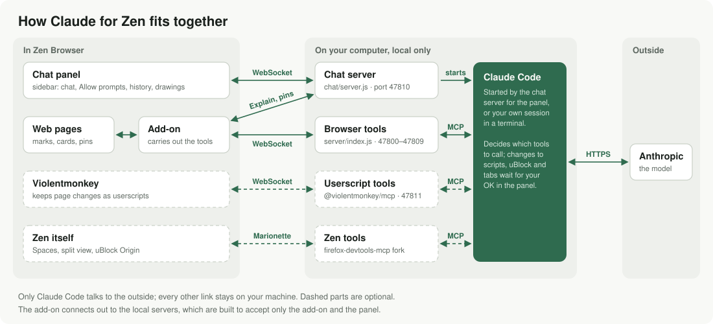

# Claude for Zen

> **Unofficial.** This is an independent, third-party project. It is not made, endorsed or supported by Anthropic or by the Zen Browser team. "Claude" is Anthropic's trademark; "Zen" belongs to the Zen Browser project. It is not a port of Anthropic's Claude in Chrome extension.

Claude Code as a browser assistant in [Zen Browser](https://zen-browser.app) (and other Firefox-based browsers). It has two parts that work together or alone:

- **Browser tools for Claude Code.** An add-on plus an MCP server: list and open tabs, read pages, click, type, fill forms, take screenshots, run JavaScript, read console and network activity, mark things on the page.
- **A chat panel beside the page.** A sidebar shows a Claude that sees and operates the page next to it, backed by a headless Claude Code on your own machine and your own Claude subscription. Optional extras let it save userscripts through Violentmonkey, tune uBlock Origin, and arrange Zen's Spaces and split views.



## Before you use it

- **It gives an AI control of your browser**, including every site you are signed in to. Web pages can contain text written to mislead it. The panel asks before risky steps, but read the *Limits* section and decide what you are comfortable with.
- **You need [Claude Code](https://claude.com/claude-code) installed and signed in.** Everything runs locally; the only thing that leaves your machine is what Claude Code itself sends to Anthropic. Check that your use fits Anthropic's terms for your plan.
- **It was built and tested on Windows 11 with Zen.** The add-on, MCP server and chat panel are plain Node and WebExtension code and should run elsewhere; the two PowerShell helper scripts (start at login, start Zen with remote control) are Windows-only.
- **It is young.** Most of it was written in a single day in November 2026, largely by an AI coding agent under the author's direction. It has had one independent security review, which found serious problems; those were fixed, but the fixes have not been reviewed in turn, and some gaps remain (see *Security*). Treat it as an experiment, not a finished product.
- **No warranty.** Parts of it lean on browser and add-on internals (uBlock Origin's in particular) and can break when those update.

## How it works

```
Claude Code ──stdio (MCP)──> server/index.js ──WebSocket on 127.0.0.1──> extension in Zen
```

- `server/` is an MCP server. Claude Code starts one per session; each takes the first free port in 47800–47809.
- `extension/` is a Manifest V2 WebExtension. Its background page looks for those ports every few seconds, connects to every session it finds, and carries out their commands. The toolbar badge shows how many sessions are connected.

## Setup

Requires Node 20+ and Zen (Firefox 128+ base).

```
npm install
npm run build        # writes dist/claude-for-zen.xpi
```

**1. Register the MCP server with Claude Code** (once):

```
claude mcp add --scope user zen -- node /full/path/to/claude-for-zen/server/index.js
```

**2. Install the extension in Zen.** Either:

- *Until the next restart:* open `about:debugging#/runtime/this-firefox` → **Load Temporary Add-on…** → pick `extension/manifest.json`.
- *Permanently:* install the latest signed build from https://github.com/Ephpotle/claude-for-zen-releases/releases/latest (or `dist/claude-for-zen-<version>-signed.xpi`) via `about:addons` → gear icon → **Install Add-on From File…**. It updates itself afterwards.

Start a new Claude Code session and ask it to do something in the browser. The tools appear as `mcp__zen__*`.

## Chat panel beside the page

Zen's AI chat sidebar (Ctrl+Alt+X) can show a Claude that sees and operates the page next to it. The panel is a small local web page; behind it runs a headless Claude Code with only the browser tools (no file or shell access), on your Claude subscription.

```
Zen chat sidebar ──> chat/server.js (127.0.0.1:47810) ──> claude -p ──> server/index.js ──> extension
```

There are two ways to open the panel. The simplest needs no configuration: press **Ctrl+Alt+C** for the add-on's own "Claude for Zen" sidebar. The other puts it in Zen's AI chat sidebar (Ctrl+Alt+X), as set up in steps 2 and 3. Both need the chat server from step 1.

1. Start the chat server: `npm run chat`. To have it start at login instead: `powershell -File scripts\autostart.ps1` (`-Remove` undoes it).
2. In `about:config`, set `browser.ml.chat.provider` to `http://127.0.0.1:47810/`.
3. Open the sidebar with Ctrl+Alt+X.

A conversation continues until you press **New chat**, and is saved (see *History* below). Nothing appears on claude.ai; transcripts are ordinary Claude Code sessions under `~/.claude-for-zen/chat`. Claude is told to treat page text as untrusted and to ask before purchases, sending messages, deleting, or final form submissions. The page and its WebSocket only accept requests from the panel's own origin with a per-run token (see *Security*).

**Optional: hide Zen's own bars.** In Zen's AI chat sidebar, Zen draws its own header, provider menu and "Summarize page" bar around the panel. The two style sheets in `extras/zen-sidebar-tidy/` collapse them to a thin strip that slides back when you point at the top edge. This is cosmetic and nothing needs it; set the provider (step 2) first, since the provider menu is one of the things it tucks away. To use it, copy both files into the `chrome` folder of your Zen profile (create the folder if needed; `about:support` shows the profile folder), set `toolkit.legacyUserProfileCustomizations.stylesheets` to `true` in `about:config`, and restart Zen. Delete the two files to undo it.

**Access** (the button in the panel header) sets what Claude may use. It applies from the next message and **belongs to the conversation you set it in**: a new chat starts with the browser only, and other windows' conversations are not affected. Tick *Use this in every conversation* to make it the default everywhere instead. A reopened conversation gets back the level it had, except that "without asking" has to be chosen again.

- *Browser only* (default): pages and tabs, nothing on the computer.
- *Browser and computer, asking first*: adds shell commands and file tools. Whatever Claude Code would normally ask permission for (file changes, most commands) appears in the panel with **Allow** / **Don't allow**. Read-only commands and reads inside the working folder run without asking.
- *Browser and computer, without asking*: the same tools, never asking. A web page that manages to trick Claude could then reach your files, so use it deliberately.

**Zen itself: Spaces, tabs and uBlock** (a checkbox under Access) adds a second MCP server: a fork of Mozilla's [`firefox-devtools-mcp`](https://github.com/mozilla/firefox-devtools-mcp) with extra `zen_*` and `ublock_*` tools. The fork is the [`zen-tools` branch of Ephpotle/firefox-devtools-mcp](https://github.com/Ephpotle/firefox-devtools-mcp/tree/zen-tools) (see its `ZEN-TOOLS.md`); everything else here works without it. Get it with `git clone -b zen-tools https://github.com/Ephpotle/firefox-devtools-mcp`, then `npm ci && npm run build:moz` inside it, and set `CLAUDE_FOR_ZEN_SPACES_MCP` to the full path of its `dist.moz/index.js` before starting the chat server (without that variable it is looked for in `../zen/firefox-devtools-mcp`). It lists, creates and reorganises Spaces, folders and tabs, which an add-on cannot reach. Listing is free; creating, moving and closing always ask in the panel, even in "without asking" mode. It also shows Claude what shares the screen (`zen_view`: the tabs in a split view, a Glance preview) and opens or ends split views (`zen_split_view`, `zen_unsplit_view`) without asking, since that only rearranges what you see.

The same server tunes **uBlock Origin** for the site in a tab (`ublock_*` tools, in the fork's `src/tools/ublock.ts`): it reads which hosts were blocked and allowed, flips the per-site switches (JavaScript, cosmetic filtering, large media, fonts, popups), sets per-host or per-type rules, and adds or removes site-specific lines in "My filters". Switches and rules are temporary until Zen restarts unless you ask Claude to keep them; "My filters" lines are permanent. Per-host rules only work with uBlock's "I am an advanced user" setting on, which Claude asks before changing. uBlock has no API for other programs, so these call the handlers its own popup uses; a uBlock update could break them.

 It only works while Zen was started with remote control on: quit Zen and use `scripts\start-zen-control.ps1` (`-Shortcut` puts "Zen (Claude control)" on the Desktop). While Zen runs that way any local program can drive it and sites can detect that it is automatable, so start Zen normally when you don't need this. `npm run test:spaces` tests both against a throwaway headless Zen on its own ports, so it can run while your Zen is open.

**Violentmonkey userscripts** (a checkbox under Access) is how a change Claude made to a page becomes permanent: Claude saves it as a userscript in [Violentmonkey](https://violentmonkey.github.io/) (2.50 or newer, installed from addons.mozilla.org as usual), and can list, fix, switch off and remove scripts. It uses Violentmonkey's own agent support through the official `@violentmonkey/mcp` server, which the chat server keeps running on 127.0.0.1:47811 (`CLAUDE_FOR_ZEN_VM_PORT`). Violentmonkey forgets its approval every time the browser starts, and needs a click on **Approve** to reconnect. When Zen starts with this option on, the add-on opens Violentmonkey's connect page by itself, so that click is all there is to do. The click is Violentmonkey's own safeguard and is not automated. Saving, switching and removing always ask in the panel, showing the pages the script runs on and its code. It works in a normally started Zen. `npm run test:userscripts` tests it against a throwaway Zen (set `VIOLENTMONKEY_XPI` to a downloaded copy if Violentmonkey is not installed in your profile).

**Look.** A line at the foot of the Access panel switches between four looks: *Sage* (the default), *Iris* (soft and rounded, violet), *Reader* (replies set as reading text in a serif) and *Ledger* (a dense transcript, amber). Each has a light and a dark version that follows your system. The choice is shared by every window.

**Model** and **Effort** (also under Access) choose the Claude model and how hard it thinks; they apply from the next message and the conversation carries on. *Default* leaves it to Claude Code (or `CLAUDE_FOR_ZEN_MODEL`, if set). `CLAUDE_FOR_ZEN_CHAT_PORT` picks the port.

## On the page

- **Marks.** Claude outlines elements and highlights passages on the page (`annotate`), with labels you can dismiss.
- **Cards.** Claude can draw a diagram or animation into a floating card (`show_card`). Generated HTML runs isolated: opaque origin, no network, none of the add-on's powers. A new card replaces Claude's earlier ones, `close_cards` removes them, and the tool reports whether the content really drew. (The HTML is handed to a sandboxed add-on page; it is not loaded from 127.0.0.1, which browsers refuse on public websites.)
- **Status line.** While Claude works, a line above the message box says what it is doing (waiting for the model, thinking, writing, the step it is running, a helper it started, waiting for your OK), how long the turn has taken and how many tokens it has written. If nothing at all has come from Claude for a while it says for how long, and the dot turns red after two minutes, so a long step and a hang look different. When the turn ends it shows the time and tokens used.
- **Helpers.** Claude can hand part of a job to a helper (a subagent), also with the browser tools alone. The step that started it shows the helper's progress and opens to its own steps. A helper can keep working after Claude's reply; Claude picks up again by itself when it reports.
- **Slash commands.** Type `/` at the start of a message for Claude Code's commands that work here (`/compact`, `/context`, `/usage`, ...) and your own skills. The list comes from Claude Code once a conversation has started. The panel's own controls replace `/clear`, `/model` and `/effort`.
- **Pictures.** Paste or drop a picture (a screenshot, say) into the message box to send it with your message, up to four at a time. Large ones are scaled down first. Only a small preview is kept with the conversation.
- **Drawings in the chat.** Claude can also draw a chart or diagram straight into its reply in the panel; the frame sizes itself to the drawing.
- **A plain window when the main one is refused.** While Zen runs with remote control on, some sites loop on "verify you are human" or refuse sign-in. Claude can offer a separate plain Zen window (own profile under `~/.claude-for-zen/plain-profile`, no add-ons, not automatable) for you to use by hand; it always asks first, and it cannot see into that window. `ZEN_PATH` names Zen's program file if it is not in the usual place.
- **Reports for the developer.** When something in the panel is broken or missing, Claude can file a report under `~/.claude-for-zen/dev-reports/` for the development session to pick up.
- **Explain.** Select text and press the **Explain** button beside it (or Alt+Shift+E, or the right-click menu). The card offers *Simpler*, *More detail* and *Show it visually*. Uses a quick model; set `CLAUDE_FOR_ZEN_EXPLAIN_MODEL` to change it. The button can be switched off from the toolbar icon.
- **Comment pins.** Alt+Shift+C (or the toolbar icon, or right-click → *Comment on this for Claude*), click any part of the page, type a note. It goes to the chat panel with the exact element attached, and the pin stays on the page.
- **Named sidebar.** Ctrl+Alt+C, or *Show or hide the chat sidebar* in the toolbar popup, opens the panel as the add-on's own "Claude for Zen" sidebar, instead of a custom provider address in Zen's AI chat sidebar. Both show the same conversation.
- **Several windows.** Each window's panel has its own conversation and its own Claude, so two windows can work in parallel (up to four at once). Reopening or reloading a panel returns to its conversation. Settings under Access are shared. Each message tells Claude which tab was in front in that window when you sent it, so "this page" stays right while you move to other tabs or windows, and new tabs open in that conversation's window. A comment pinned on a page goes to the conversation of the window it was pinned in. When Claude is waiting for your OK in a window you are not looking at, the other panels say so and the toolbar button shows a "?". The Zen Spaces and uBlock tools have a single connection to the browser, so only one conversation can use them at a time. `npm run test:parallel` tests this.
- **History.** Conversations are saved under `~/.claude-for-zen/chat/conversations` and survive restarts. *New chat* files the current one; A new conversation can look up earlier ones when you refer to them ("do what you did for that other site"): steps are saved with their inputs, except text typed into pages. *History* reopens, renames, archives or deletes past ones. Starting a new chat or opening another conversation while Claude is working does not stop it: it carries on in the background (up to four at once) and is marked *working* in History; one that is open in another window is joined rather than opened twice. `node scripts/recover-chat.js` rebuilds one from a Claude Code transcript.

Explain, comments and the sidebar need the chat server running. Everything on the page is temporary and disappears on reload.

## Releasing

`./scripts/release.sh [version]` bumps the version, has Mozilla sign the add-on (unlisted), and publishes the signed `.xpi` plus `updates.json` to a public releases repository (`CLAUDE_FOR_ZEN_RELEASES_REPO`, default `Ephpotle/claude-for-zen-releases`). Installed copies update themselves from there. `--sign-only` skips publishing. It needs your own AMO API key in `WEB_EXT_API_KEY` / `WEB_EXT_API_SECRET`. If you fork this, also change the add-on id and `update_url` in `extension/manifest.json`, or your build will update itself from the original releases.

## Tools

| Tool | What it does |
| --- | --- |
| `tabs_list`, `tab_create`, `tab_close` | Manage tabs |
| `navigate` | Go to a URL, or `back` / `forward` / `reload`; waits for the load |
| `read_page` | Outline of the page with `ref` IDs for each element |
| `find` | Find elements by text, label or CSS selector |
| `get_page_text` | Readable text of the page |
| `click`, `hover`, `scroll` | By `ref` or viewport coordinate |
| `type`, `key`, `form_input` | Keyboard input and form controls |
| `annotate`, `clear_annotations`, `show_card` | Mark things on the page; show generated HTML in a floating card |
| `get_selection` | The text the user has selected, with context |
| `screenshot` | JPEG of the viewport; pixels match click coordinates |
| `javascript` | Evaluate code in the page |
| `wait_for` | Wait for text, a selector, or a number of seconds |
| `console_messages`, `network_requests` | What the tab logged and requested |
| `resize_window` | Resize the browser window |

## Limits worth knowing

- **Input is scripted, not real.** Firefox gives extensions no debugger API, so clicks and keys are dispatched as DOM events. Nearly all sites accept them, but a site that insists on trusted events will ignore them, native `<select>` dropdowns don't open (use `form_input`), and file inputs can't be set.
- **Unloaded tabs.** Zen unloads tabs you have not used for a while. Claude using one loads it again in the background, which takes a few seconds and can lose unsaved form input.
- **Private windows and Zen-only views.** The add-on only sees private windows if you allow it in `about:addons`. It cannot see which Space a tab is in, which tabs share a split view, or that a page is open in Glance; the Zen Spaces tools cover those, when Zen runs from the control shortcut.
- **Containers.** A tab Claude opens uses the same container as the page you are on, so it shares that page's logins (this is why the add-on asks for the cookies permission).
- **Top frame only.** Content inside iframes is not outlined or clickable.
- **Console and network capture start when Claude first uses a tab.** Reload to capture a page's startup.
- **Strict CSP pages:** on pages whose security policy forbids eval (GitHub, for one), `javascript` runs the code as a function in the page instead. It works the same for a single expression; code with several statements has to `return` its result. Either way the code runs as a script of the page, never with the add-on's powers.
- **Restricted pages** (`about:`, the add-ons site, reader view) can't be touched by any extension.
- **Claude can act on any open tab**, including ones you opened, in whatever profile the extension is installed in. Sessions you are logged into are available to it.
- **Local trust.** Websites cannot reach the local servers: they accept the chat panel's own page and the add-on only, and of the installed add-ons only the first one seen (kept in `~/.claude-for-zen/addon-origins.txt`; delete that file after reinstalling the add-on or to use another profile). Other *programs* on your computer are a different matter: one that listens on a port in 47800–47809 before a real session does is treated by the add-on as a session and can drive the browser, and anything running as you can read the files in `~/.claude-for-zen`.

## Security

The design question is what a Claude that has been misled by a web page can do without you. Text on a page, a tab title or a userscript can be written to steer it, so assume it will try things you did not ask for.

What is enforced in code, not just asked of Claude:

- **Claude cannot touch Claude for Zen's own pages.** The add-on refuses every tool on the chat panel, the local servers and its own pages, so Claude cannot change its access level, type into the panel as you, or press Allow on its own requests.
- **Websites cannot talk to Claude as you.** A link to the panel with a prompt attached only fills the message box. The panel's token never leaves its page.
- **Cards and drawings run sealed.** Generated HTML gets an opaque origin, no network and none of the add-on's powers, and the card page refuses to run if a website frames it without that seal.
- **Changes that persist ask first:** userscripts, uBlock rules and filters, moving or closing tabs, opening a plain browser window. For userscripts the prompt says where the script runs (in capitals if that is everywhere), what it loads and whether it replaces itself later.

What is by design and you should know:

- **In every Access mode, Claude can read and act on any open tab without asking**, including running script in it. "Browser only" means "nothing on the computer", not "asks before acting in the browser". The panel asks Claude to check with you before purchases, messages and deletions, but that is an instruction, which a misleading page can talk it out of.
- **With computer access, the Allow prompts are the only barrier, and they show the command or the file path, not what a file will contain.** "Without asking" has no barrier: a misled Claude then has your shell, and with that it can also get round the prompts for userscripts and uBlock.
- **Saved conversations hold what Claude did**, including scripts it ran and commands, under `~/.claude-for-zen/chat/conversations`. Text typed into pages and the Violentmonkey token are left out. A later conversation can read earlier ones.

Known gaps, found by an independent review in November 2026 and not fixed yet:

- A page can read what you type into a comment pin's box, and may be able to add text to it as you send it. Avoid pinning comments on pages you do not trust.
- A page can tell that the add-on is installed and that Claude is using the tab.
- The Violentmonkey token is handed to Claude as part of the connect address (that is how Violentmonkey's own server works), so with computer access Claude could use it directly.
- Write and Edit prompts show only the path.

Reports of security problems are welcome as GitHub issues, or privately through the repository's security advisories.

## Development

```
npm run zen     # throwaway Zen profile with the extension loaded (welcome screen skipped)
npm test        # end-to-end test: launches Zen, drives a local page through every tool
npm run test:chat   # real conversation through the chat server (needs Zen running with the add-on)
npm run test:overlay   # marks, cards, Explain, comment pins, history (uses its own port; your panel is left alone)
npm run lint
```

`ZEN_PATH` overrides the browser location for `npm test`.

## Support and contributing

This is a personal project. There is no promise of support, of a response to issues, or of future releases; it may change or stop at any time.

Bug reports and pull requests are welcome all the same. Before sending a change:

- The tests are not run automatically. They need a local Zen and a signed-in Claude Code, and the ones that talk to Claude use your subscription: `npm test` (browser tools), `npm run test:overlay` (everything drawn on pages), `npm run test:parallel` (the chat server), and `npm run test:spaces` / `npm run test:userscripts` for the optional parts.
- The tests start their own throwaway browser and their own chat server on other ports, and do not touch a browser or panel you have open.
- Anything that changes what Claude may do without asking belongs in the *Security* section too.

The signed builds are in [claude-for-zen-releases](https://github.com/Ephpotle/claude-for-zen-releases); each one is tagged here as `v<version>` on the commit it was built from.

## Licence

[MIT](LICENSE). Uses [`@violentmonkey/mcp`](https://github.com/violentmonkey/mcp) (MIT) for the userscript option.
